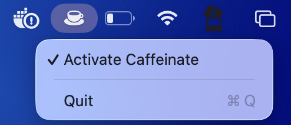

# Caffeinate manager

A small macOS menu bar app that keeps your Mac awake. It's a one-click switch for the built-in `caffeinate` command.

## Install

1. Download the zip from the [latest release](https://github.com/LadariousX/Caffeinate-manager/releases/latest) and unzip it.
2. Move `Caffeinate manager.app` to your Applications folder.
3. Open the app. macOS will block it the first time, because the app isn't notarized by Apple.
4. Go to **System Settings > Privacy & Security**, scroll down, and click **Open Anyway**.
5. Optional: add it under **System Settings > General > Login Items** to start it at login.

Requires macOS 15.7 or later, on Apple silicon or Intel.

## Usage

Click the cup icon in the menu bar, then click **Activate Caffeinate**. A check mark appears and the cup fills in while your Mac is being kept awake. Click it again to turn it off.

Choosing **Quit** also turns it off.

## Build from source

Open `Caffeinate manager.xcodeproj` in Xcode and run the `Caffeinate manager` scheme.
